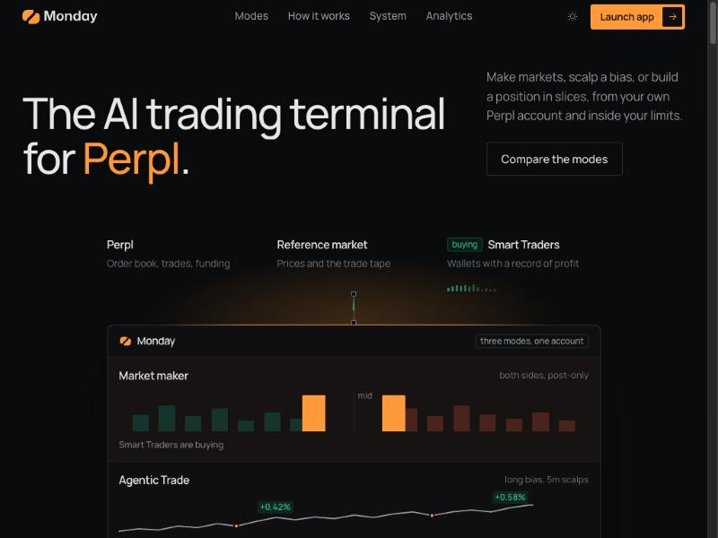
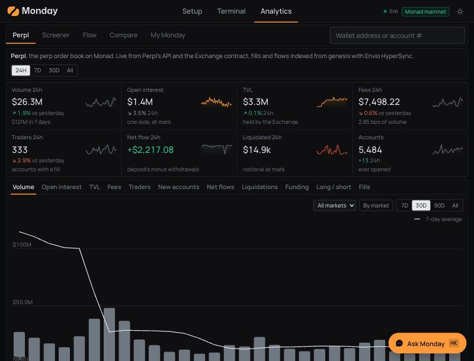

# Monday

**The AI trading terminal for [Perpl](https://perpl.xyz), the on-chain order book on Monad.** Make markets, scalp a bias, or build a position in slices, from your own Perpl account and inside your limits. Kimi is the risk governor. Alongside it: public analytics for all of Perpl, with a chat that answers from on-chain data.

[](https://github.com/moudybk1/monday/actions/workflows/ci.yml)
[](LICENSE)
[](https://app.mondaytrade.xyz)

[](https://mondaytrade.xyz)

**Live, on Monad mainnet with real funds:**

| | |
| --- | --- |
| [app.mondaytrade.xyz](https://app.mondaytrade.xyz) | The terminal: sign in with a wallet, set up a mode, watch it trade. Every decision has a public record. |
| [analytics.mondaytrade.xyz](https://analytics.mondaytrade.xyz) | Perpl analytics, open to anyone, no wallet needed. |
| [mondaytrade.xyz](https://mondaytrade.xyz) | What Monday is and how it works. |
| [mondaytrade.xyz/system](https://mondaytrade.xyz/system) | Every part in detail, and what Kimi decided on mainnet. |

Built for **Monad Metropolis (Track 01)**, with entries for **Perpl's Best Analytics / Risk Tool bounty** and the **Kimi bounty**. The analytics index Perpl's full history through **Envio HyperSync**.

## Three ways to trade

Each mode trades from the user's own Perpl account, in markets of its own, and stops at a loss the user sets. All three can run at once.

| | Agentic Market Maker | Agentic Trade | TWAP |
| --- | --- | --- | --- |
| **What it does** | Quotes both sides of the book in the markets you choose and earns the spread. | Scalps your long or short bias on one market, again and again, on a 1m, 5m or 15m timeframe. | Builds a position in slices, as maker orders where it can, so one large order does not move a thin book. |
| **Runs** | Until you stop it. | Up to a week, or until the stop loss or take profit on its margin. | Up to 24 hours to build, then held until its stop, its target or you close it. |
| **Kimi's part** | Reviews spread and size every 15 minutes, inside hard bounds. Never places an order. | Sums up D1, H4 and H1 before you start. Code reads the trend and picks every entry. | Sums up the market before you start. Code places every slice. |
| **Protection** | A daily stop loss on the margin: at it, Monday cancels its orders and closes the positions. | Every scalp's stop and target rest on Perpl from its fill. | A price it must not pass while building, and a stop loss on Perpl from the first fill. |

**Custody.** Funds never leave the user's Perpl account. Monday holds a trade-scoped Perpl API key, stored encrypted; Perpl never lets any API key withdraw. Stop, Kill and revoking the key are one click each. Sign-in is a signed message (SIWE), no gas.

## How the market maker thinks

Three loops on three clocks. The fast ones are plain code, so nothing urgent ever waits for a model.

- **Engine, every second.** Fair price from Perpl's book blended toward the reference market (Hyperliquid, which Perpl follows), spread from volatility and the user's floor, inventory and order-book skew, quote size capped at a share of an hour's volume. One entry per position: once a position is open only its exit is quoted, in profit or at breakeven after ten minutes. Post-only, never crossing the book. Deterministic and unit tested.
- **Reflex, the next tick.** Pulls or widens the side about to be run over: a Smart Trader burst (wallets with a consistent profit record, from Nansen's labels), a move in the reference market before Perpl's book catches up, or a fill on Monday's own quote.
- **Governor, every 15 minutes.** Kimi (`kimi-k3`) reads the whole situation (flow, volatility, funding, the position, PnL and fill quality, the user's limits, what the fixed rules would set) and answers with bounded parameters and a reason in plain words. Code validates and clamps every value, hashes the decision with its evidence and publishes it at `/decisions/<id>`. If Kimi is slow or down, the rules answer. Kimi never places an order.

**Risk controls on every order:** a 1% band around the oracle, position and account caps, a leverage check, the user's daily stop loss (kill and flatten at 100%, a warning at 70%), a margin floor below which Monday closes everything before Perpl's maintenance margin, a stale-data kill at 30 seconds, and a kill after three failed orders in a row. Kill cancels every order and closes every position on the account.

## Perpl analytics

[](https://analytics.mondaytrade.xyz)

Every Perpl trade since launch, indexed from Monad for all 11 markets, refreshed every few seconds.

- **Protocol.** Volume, open interest, TVL, fees and active traders over 24h, 7d, 30d and all time; daily series; collateral flows; per-market funding and long/short; a liquidation map, positions closest to liquidation, the largest positions and the latest liquidations; who makes money, retention cohorts, when Perpl trades.
- **Flow.** What Perpl's top traders, consistent winners and whales hold and how they moved over 1h, 6h and 24h, and a live tape of their orders.
- **Wallets.** Search by address or account number: equity, open positions with liquidation prices, trade history with realised PnL, win rate, profit factor, drawdown, streaks, hold time, best and worst markets, rank among active accounts. Compare up to four wallets. A screener with presets (winners, streaks, whales, makers, takers, liquidated, losers) and leaderboards for 1, 7, 30 and 90 days.
- **Ask Monday.** A chat on every analytics page. Rules answer the common questions at once; Kimi turns free-form questions into a structured query the code answers with real figures, and writes plain-words wallet summaries from a sheet of live facts. A reply that quotes a figure not on that sheet is discarded.
- **Data.** Perpl's Exchange contract events from genesis through Envio HyperSync (fills with fees, positions, liquidations, deposits, withdrawals), the chain head over RPC while HyperSync is rate-limited, and Perpl's API and contract reads for live funding, the book and open positions.

## Run it

Requires Node 22.13 or newer.

```bash
npm install
npm run dev
```

Open http://localhost:3000. With no `.env` everything runs on a simulated market: the landing page shows the house account quoting, **Launch app, then "Use a demo account"** walks the real onboarding (any token and secret pass the key step), and the terminal's "Buy burst / Sell burst" fires a Smart Trader burst so you can watch the reflex pull a quote.

To run on Perpl's real prices without trading, use paper mode: the book, the tape, the candles and the Smart Trader feed are real, orders are simulated and fill the way a real order at that price would, queue position included.

```bash
VENUE=paper NETWORK=mainnet npm run dev
```

### Going live

Copy `.env.example` to `.env`. Each block switches one piece to live; they are independent.

| Piece | Default | Goes live when |
| --- | --- | --- |
| Smart Trader data | Simulated trades | `NANSEN_API_KEY` (Nansen Smart Money perp trades; first boot backfills 7 days) |
| Execution venue | Simulated book and fills | `VENUE=perpl` and `MONDAY_MASTER_KEY`. Testnet unless `NETWORK=mainnet`. |
| Governor and Ask Monday | Rule-based | `LLM_API_KEY` (Kimi through an OpenAI-compatible endpoint, or Anthropic) |
| Perpl history | Recent hours over RPC | `ENVIO_API_TOKEN` (HyperSync, full history in minutes) |
| On-chain policy and decision log | Hashed, not anchored | `MONDAY_REGISTRY_ADDRESS` and `AGENT_LOGGER_PRIVATE_KEY` |
| Alerts | Off | `TELEGRAM_BOT_TOKEN` and `TELEGRAM_CHAT_ID` |

Live orders are never driven by simulated signals: with a live venue and no Nansen key there is no Smart Trader signal at all, and the regime rests on volatility alone.

Before a user can trade on Perpl: deposit AUSD on Perpl to open an exchange account, turn on **One-Click Trading** in Perpl's settings, and create a key with **trade** scope on Perpl's `/apikeys` page.

### Real funds

`NETWORK=mainnet` with `VENUE=perpl` places real orders with real collateral. The server refuses to start in that mode until `ALLOW_REAL_FUNDS=yes` is set, checks the RPC's chain id at boot, and requires every policy to carry the margin for its full inventory plus the whole daily loss, so the loss kill fires before Perpl's maintenance margin. Optional operator caps (`CAP_QUOTE_USD`, `CAP_INVENTORY_USD`, `CAP_DAILY_LOSS_USD`) bound every user's policy. Agentic Trade and TWAP need `PLANS_LIVE=yes` on real funds.

Monday has traded real funds on mainnet since 2026-10-08. Try changes in paper mode first. Perpl geo-blocks some countries; host the server where Perpl serves users.

## Deploy

One machine runs the trading server, the stats process (indexer and `/api/stats`, kept apart so heavy analytics never stalls trading), the web app and Caddy for TLS.

```bash
git clone https://github.com/moudybk1/monday.git && cd monday
cp .env.example .env     # DOMAIN, WEB_ORIGIN (https://app.<DOMAIN>), API_PUBLIC_URL, SITE_URL, APP_URL, ANALYTICS_URL, SESSION_SECRET, MONDAY_MASTER_KEY
docker compose --env-file .env -f infra/docker-compose.yml up -d --build
```

Point A records for `DOMAIN`, `app.DOMAIN` and `analytics.DOMAIN` at the machine; Caddy fetches the certificates. On a host that already runs Caddy, add `infra/docker-compose.host-caddy.yml` and `infra/host-caddy.caddy`. Data lives in `apps/server/data` on the host; back it up daily with `scripts/backup-db.sh`. Never run two Mondays on the same Perpl account.

## How it is built

```
apps/web         Next.js 16: site, terminal, setup, analytics, decision records
apps/server      One Node process: REST + WebSocket API, Smart Trader collector, per-user runners, plans, governor
  src/venue      The seam. sim.ts simulates, paper.ts fills against the real tape, perpl/ is the live adapter
  src/stats      Its own process: Perpl indexer (HyperSync + RPC) and the public /api/stats API
packages/core    Pure strategy math and shared types: quoting model, reflexes, scalper, plans, analytics
contracts        MondayRegistry (Solidity 0.8.24, Foundry): user limits and decision hashes on Monad
infra            Dockerfiles, docker-compose, Caddyfile
docs             Design reports and research notes
```

The web app only talks to its own origin (`/api` is proxied), so the session cookie is httpOnly and SameSite=Strict; the live stream uses a one-time ticket. Perpl keys are sealed with AES-256-GCM and decrypted only in memory when a session opens. Every order passes one risk gate, leaves through one scheduler that serves risk work first, and is written down with the market it saw, so any fill traces back to the quote, the signal and the decision behind it.

The interface is a trading terminal, measured against live ones rather than built from a template: dark first with a light theme one click away, Manrope throughout with nothing under 12 px, colour rationed to bid, ask and "this is Monday's", a fixed-viewport panel grid on desktop.

## Checks

```bash
npm test                 # strategy, runner, plans, paper venue, collector, governor, analytics, and a replay of Perpl trading frames
npm run typecheck
npm run build            # production build of the web app
cd contracts && forge test                                   # 25 tests incl. fuzz and invariants
cd apps/server && npx tsx src/venue/perpl/smoke.ts           # live Perpl: context, book, candles, account lookup
```

CI runs typecheck and the tests on every push and pull request.

## Honest limits

- The market maker's edge is not proven. Replays and live fills say the exits in profit and the reference-market guard help; fees and adverse fills can still make a round trip lose. Monday reports results and does not promise profit.
- Smart Trader signals can be wrong or late. The reflexes and the governor shrink or step aside; they never predict.
- `MondayRegistry` passes its 25 Foundry tests but is not deployed in this deployment, so decisions are hashed and published by the app rather than anchored on Monad.
- Kill closes every position on the account, the user's own included: it is the emergency stop, not a selective one.
- The Perpl adapter was written from Perpl's public API docs; no Perpl example code was copied.
- The code, tests and docs were written with Claude Code, directed and reviewed by the author; commits it helped with carry a `Co-Authored-By: Claude` trailer. At runtime the governor itself is an LLM.

## License

MIT
